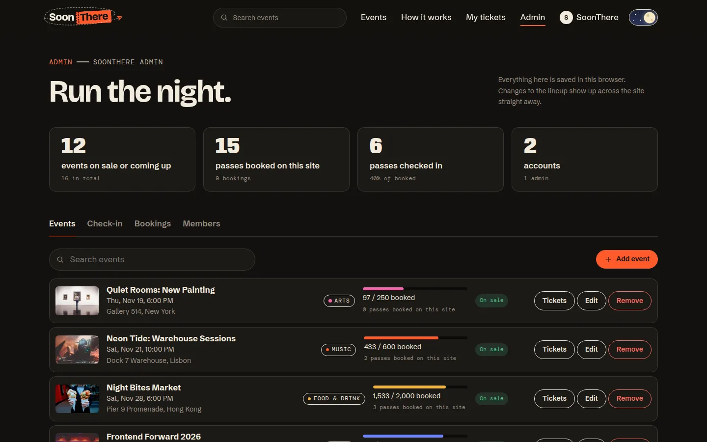

# SoonThere

**An event management website for discovering events, registering for them and managing every booking in one place.**

Live site: **https://soonthere.vercel.app**


SoonThere lists gigs, talks, tastings, workshops and late nights in cities around the world. Visitors browse upcoming and featured events, search and filter them by category, open any event for its full details and register in about a minute. Registrations are saved in the browser's Local Storage, where they can be reviewed and cancelled, and organisers get an admin area to manage events and check people in at the door.

It is built with HTML5, CSS3 and plain JavaScript, with no framework and no build step, and works on phones, tablets and desktops.

## Features

### Discover events
- **Hero dial.** Upcoming events sit on the rim of a wheel that turns on its own. Drag it, swipe it, or use the arrow buttons and keys. The selected event is shown in full with a live countdown, and its photo fills the stage.
- **Featured events.** Three highlighted events as large poster cards.
- **Upcoming events.** Every event as a card with its name, date, venue, image and a short description.
  - Search by name, venue, city, organiser or tag, accents ignored.
  - Filter by category, with live counts.
  - Sort by date, popularity or price.
  - Show past events, which appear under their own "Already happened" divider.
  - Filters are kept in the URL, so a filtered view can be shared.
- **Search from any page.** The header search suggests events as you type and hands the search over to the lineup.

### Event details
- Date, time and venue in the venue's own time zone, with your local time alongside when it differs.
- Price, spots left, a live countdown, the description, highlights, the schedule and a map link.
- **Register**, **Add to calendar** (an `.ics` file) and **Share**.
- Sold-out, started and finished events say so instead of offering registration.

### Registration
The form collects the participant's **name, email, phone number and the selected event**, plus the number of passes and an optional note. Everything is validated in JavaScript before it is saved:

| Field | Rule |
| --- | --- |
| Name | 2 to 60 characters; letters (including accented ones), spaces, hyphens and apostrophes |
| Email | A valid address that hasn't already registered for this event |
| Phone | 7 to 15 digits, an optional `+`, and spaces, dashes or brackets |
| Event | Must exist and still be open |
| Passes | 1 to 5, and never more than the spots left |

Fields are checked when you leave them and again on submit, and errors appear beside each field and are announced to screen readers. A pass preview fills in as you type, and the form warns about clashes with your other bookings. A successful registration ends with a confirmation message, **"You're in! See you SoonThere."**, along with a booking number and the pass.

### My tickets
- A timeline of upcoming bookings, with a 24-hour clock wheel and a calendar wheel that turn to the selected pass.
- A season heatmap of the days you're going out.
- Past events on a "Been there" film strip.
- Open any pass to see it in full, add it to your calendar or cancel it. Cancelled spots go back on sale straight away.

### Accounts and admin
- **Accounts are optional.** Guests can register straight away. Signed-in members get their details filled in and their bookings kept together.
- **The admin area:**
  - an overview of events, bookings and check-ins
  - add, edit and remove events, including their time zone and cover photo
  - check in by booking number, catching unknown or already-used passes
  - search and cancel bookings, and export them as CSV
  - manage members and admin access

### Throughout
- **Light and dark mode.** Follows your system setting until you choose, then remembers your choice.
- **Countdown timers** on the hero, featured events and event pages.
- **Animations.** Page transitions, scroll reveals and a paper-plane logo. There's also a footer wordmark drawn as a crowd that gathers round your pointer or finger. All motion respects the "reduce motion" setting.
- **Responsive** from 360px phones to wide desktops.
- **Accessible.** Semantic HTML, keyboard support, visible focus and labelled form errors.

## Screenshots

| Upcoming events | Event details |
| --- | --- |
|  |  |
| **Registration confirmation** | **My tickets** |
|  |  |
| **Admin area** | **Dark mode** |
|  |  |

<p align="center"></p>

## Try it

The sign-in page has a button for each demo account that signs you straight in.

| Account | Email | Password | What you'll see |
| --- | --- | --- | --- |
| Demo member | `user1@soonthere.app` | `soonthere-demo` | Upcoming bookings on the timeline and heatmap, and past events on the "Been there" strip |
| Admin | `admin@soonthere.app` | `soonthere-admin` | The admin area. Try checking in booking `ST-K7M2QX`, then scanning it again |

There is no server behind the site. Events edited by admins, accounts and registrations are stored in the browser's Local Storage, so they stay on that device. Passwords are salted and hashed with SHA-256 rather than stored as text, but a real launch would move all of this to a backend.

## How it's built

```
index.html        home: hero, featured events, upcoming events, how it works
event.html        event details (?id=)
register.html     registration form and confirmation (?event=)
tickets.html      My tickets
account.html      sign in and create an account
admin.html        admin area
404.html          not found
css/              design tokens and themes, layout, components, page styles
js/
  app.js          shared on every page: theme, header, search, animations
  data/           the events
  lib/            storage, catalogue, search, accounts, validation, formatting
  components/     event cards, countdowns, hero dial, pass, header search, footer crowd
  pages/          one module per page
assets/           event photos, favicon, share image
```

- **No framework, no build step.** Each page loads one ES module that imports what it needs, so the site is plain static files.
- **One source of truth.** Every page reads events through a small catalogue module. When an admin edits the events, the edited list is saved in Local Storage and used everywhere.
- **Local Storage.** Registrations, accounts, the session and the theme each have their own key. Every read and write is guarded, so browsers that block storage still work. Changes sync across open tabs.
- **Time zones.** Times are stored in UTC with the venue's IANA time zone and formatted with the `Intl` APIs, so an 8 pm show in Lisbon reads 8 pm everywhere. Prices use each event's local currency.
- **Safe rendering.** Markup is built with a tagged template that escapes every value, so nothing typed into a form can become HTML.
- **Progressive enhancement.** View transitions, styled dropdowns, the share sheet and the canvas crowd are used where supported, and the site works without them.

## Quality

- **Lighthouse** (live site, main pages):
  - Accessibility, Best Practices and SEO: 100 on every page
  - Performance on desktop: 98–100
  - Performance on mobile: 97–99, and 85 for the home page with its full-screen hero
- HTML validated on every page, and no issues from the axe accessibility checker in light or dark mode.
- Tested at 360, 390, 768, 1024, 1280 and 1440px wide, with no horizontal scrolling.

## Running locally

The pages use ES modules, so serve the folder over HTTP rather than opening the files directly:

```bash
python3 -m http.server 8000
```

Then open http://localhost:8000.

## Deployment

Deployed on Vercel from this repository. There is no build command; every push to `main` goes live automatically.

<details>
<summary><strong>Project brief coverage</strong> (K Explore Web Designing)</summary>

| Requirement | Where |
| --- | --- |
| Hero section introducing the platform | Home page, top |
| Upcoming and featured events | Home page: Featured events, then Upcoming events |
| Event cards with name, date, venue, image and short description | Upcoming events and related events |
| Browse, search and filter by category | Upcoming events section and the header search |
| Event details with a registration option | `event.html` |
| Registration form with name, email, phone and selected event | `register.html` |
| JavaScript form validation | `js/lib/validate.js`, `js/pages/register.js` |
| Confirmation message on success | After registering |
| Responsive on mobile, tablet and desktop | Every page |
| HTML5, CSS3, JavaScript; Git and GitHub | This repository |
| Bonus: dark/light mode, countdown timers, animations, Local Storage registration management | All included |
| Deployed link and README | Vercel, this file |

</details>

## Credits

- **Photos** from [StockSnap](https://stocksnap.io) (CC0) by Søren Astrup Jørgensen, Nainoa Shizuru, Jens Thekkeveettil, Daria Nepriakhina, Startup Stock Photos, Toa Heftiba, Burst, Ryan McGuire, Freestocks.org, Matthew Kane, Skitter Photo, Austin Neill, Anthony Delanoix, Matt Bango, Barn Images and Tohm Brigitte.
- **Fonts** from Google Fonts: Bricolage Grotesque, Schibsted Grotesk, DM Mono and Anybody.
- **Events** are fictional. No real tickets are sold and nothing is charged.

## Copyright

© 2026 Sarban Kumar Jena. All rights reserved. See [LICENSE](LICENSE).
