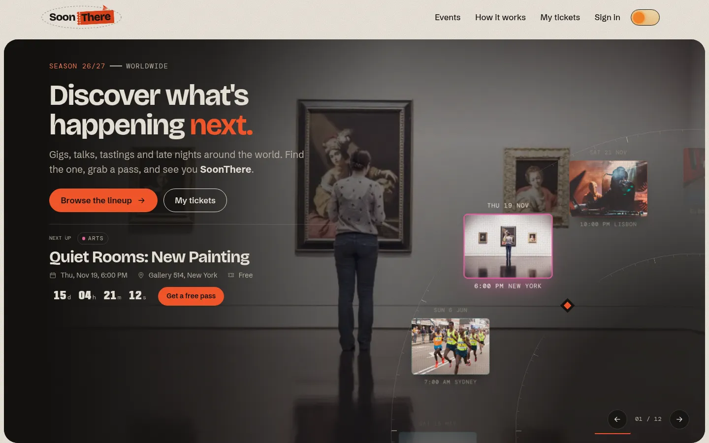
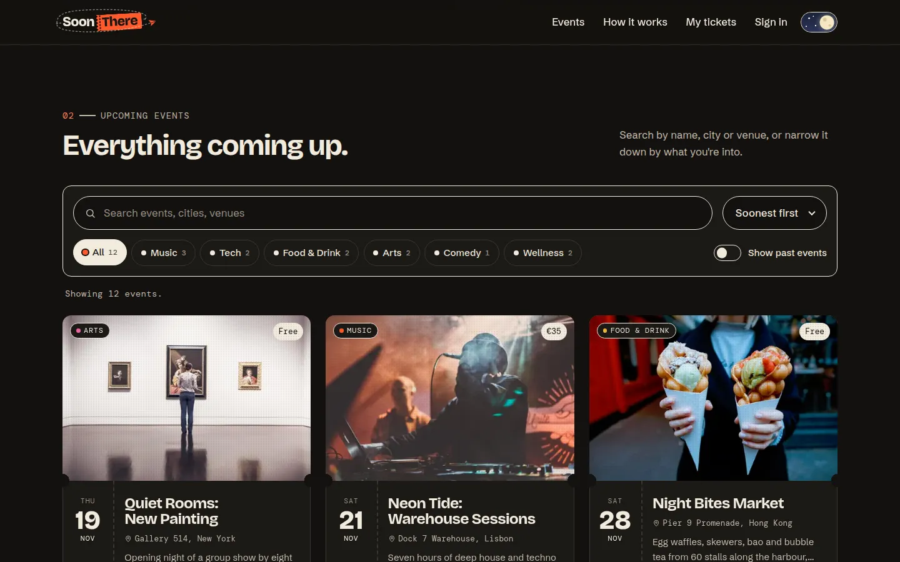
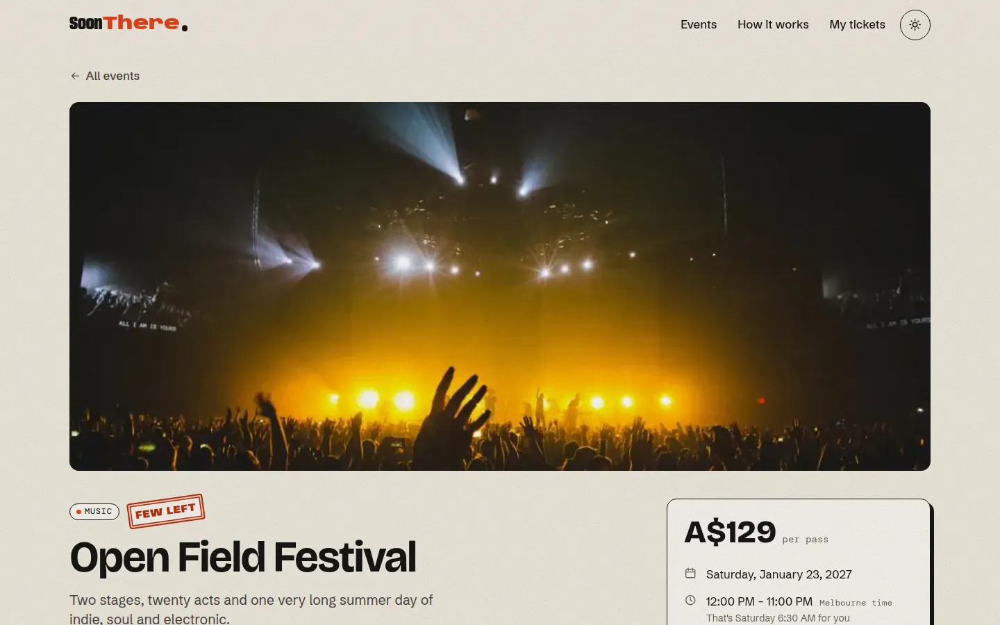
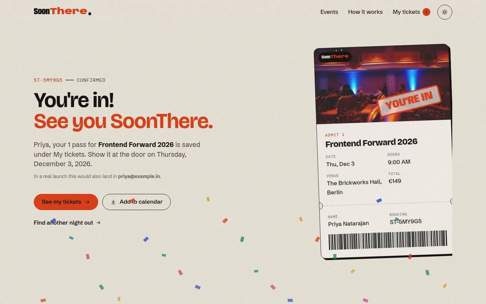
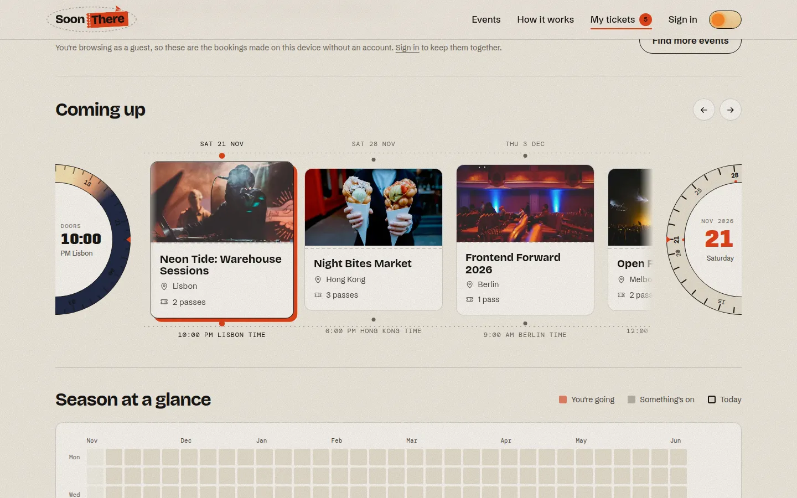
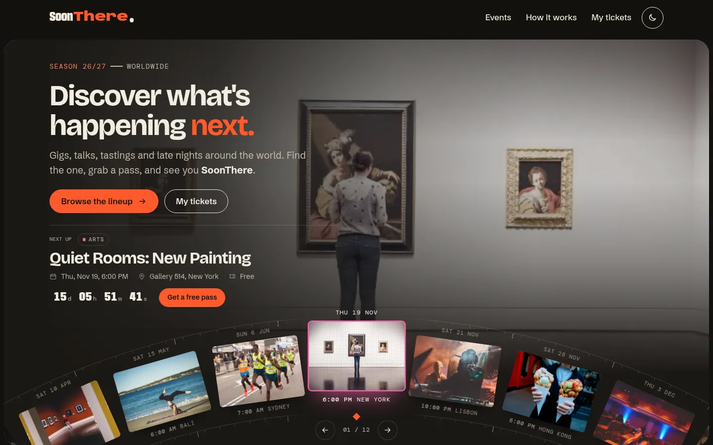
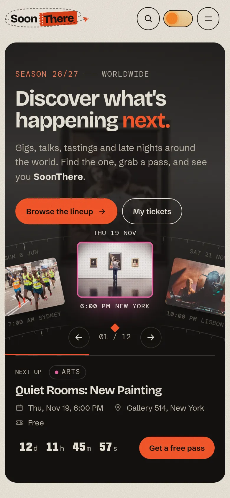

# SoonThere

**Discover what's happening next. See you SoonThere.**

SoonThere is an event discovery and booking site. You can browse gigs, talks, tastings and late nights in a dozen cities, look up the details of any event, register for passes, and keep track of everything you've booked. It's built with plain HTML, CSS and JavaScript, with no frameworks and no build step.

**Live site:** https://soonthere.vercel.app



---

## What it does

### Home
- **Hero dial.** Upcoming events sit on the rim of a large wheel, like the face of a clock. The event under the pointer is shown in full (title, date, venue, price, a live countdown) and its photo fills the background. The dial turns on its own every few seconds, and you can also drag it, swipe it on a trackpad, use the arrow buttons or the arrow keys. It pauses while you're hovering or using the keyboard.
- **Headliners.** Three featured events as large poster cards with live countdowns.
- **The lineup.** Every upcoming event as a ticket-style card with its name, date, venue, image and a short description.
  - **Search.** Matches names, venues, cities, organisers and tags, and ignores accents, so "alcantara" finds "Alcântara".
  - **Category filters.** Each one shows a live count of matching events.
  - **Sorting.** By date, popularity or price. Prices are in local currencies, so they're roughly converted before comparing.
  - **Past events.** A switch shows events that have already happened.
  - **Shareable filters.** Search and filter settings are kept in the URL, so a filtered view can be shared or bookmarked. Press `/` to jump to the search box.



### Event page
- **Cover photo.** It starts tinted in the event's category colour and fades up to full colour. In browsers that support cross-page view transitions, the card you clicked morphs into this cover.
- **Ticket panel.** Price, date and venue, plus a live countdown and a bar showing how many spots are left. Times are shown in the venue's local time, with a note of what that is in your own time zone when it's different.
- **Details.** A description, highlights, a timeline of the day, the venue with a link to maps, and tags.
- **Calendar and sharing.** "Add to calendar" downloads an `.ics` file. "Share" uses the phone's share sheet where there is one and copies the link everywhere else.
- **Booking states.** Sold-out, already-started and finished events say so instead of offering a Register button.
- **More like this.** Related events at the bottom of the page.
- **Phones.** A small booking bar slides up once the main Register button has scrolled out of view.



### Registration
- **Fields.** Name, email, phone and the event (pre-selected when you arrive from an event page). There's also a number of passes, an optional note and a tick box for the house rules.
- **Validation.** Every field is checked in JavaScript before anything is saved:
  - **When it runs:** a field is checked when you leave it, then on every keystroke once it has shown an error. The whole form is checked again on submit, and the first problem gets focus.
  - **Name:** 2 to 60 characters, using letters (including accented ones), spaces, hyphens and apostrophes.
  - **Email:** a practical format check, plus a check that this email hasn't already booked this event.
  - **Phone:** international numbers with 7 to 15 digits and an optional `+`. Spaces, dashes, dots and brackets are allowed.
  - **Passes:** 1 to 5, and never more than the spots left.
  - **Event:** must exist and still be open. Sold-out events can't be booked.
  - **Errors:** each one appears next to its field and is linked to it for screen readers with `aria-describedby` and `aria-invalid`.
- **Clash warning.** If the new booking overlaps one you already have, or is in another city only a few hours away, the form warns you but still lets you book.
- **Live pass preview.** A ticket next to the form fills in as you type.
- **Confirmation.** On success the pass is saved and the form is replaced by a confirmation: **"You're in! See you SoonThere."** It shows a stamped pass with a booking number such as `ST-K7M2QX` and offers an "Add to calendar" button.



### My tickets
- **Coming up.** A sideways timeline of your bookings, with a date rail above the passes and a time rail below. A clock at one end shows the local start time of the pass in focus. A tear-off calendar at the other end tears a page away as you move forward and sticks it back as you go back.
- **Season at a glance.** A heatmap of the whole season. Days you're going are highlighted, other days with events are shaded, and clicking a highlighted day jumps to that booking.
- **Been there.** Past bookings on a strip of film.
- **Pass details.** Open any pass to see it in full, add it to your calendar or cancel it. Cancelling asks for confirmation, and the spots go back on sale straight away. A "clear everything" option is there too.



### Everywhere
- **Light and dark themes.** The site follows your system setting until you pick one, then remembers your choice. The new theme spreads out in a circle from the toggle button.
- **Countdown timers.** Shown on the hero, the headliners and the event pages.
- **Animation.** Scroll reveals, marquee tapes, a 3D tilt on cards, magnetic buttons and page transitions. All motion is turned off for people who set "reduce motion" in their system settings.
- **Responsive layout.** Built mobile first and tested at 360, 390, 768, 1024, 1280 and 1440 pixels wide.
- **A custom 404 page.** "Wrong venue."

| Dark mode | On a phone |
| --- | --- |
|  |  |

---

## How it's built

```
index.html        home: hero dial, headliners, lineup, how it works
event.html        one event, picked with ?id=
register.html     registration form and confirmation, event picked with ?event=
tickets.html      My tickets
404.html          not found
css/
  base.css        design tokens, light and dark themes, reset, type
  layout.css      header, mobile menu, footer
  components.css  buttons, chips, ticket cards, form fields, countdown, toasts
  pages.css       page-specific styles
js/
  app.js          shared on every page: theme, header, reveals, tilt, toasts
  data/events.js  the events themselves
  lib/            dom helpers, date and price formatting, storage, catalogue, validation, .ics export
  components/     event cards, countdown, hero dial, pass
  pages/          one module per page
assets/           favicon, share image, event photos
```

### Notes on the implementation

- **No build step.** Every page loads a single ES module (`js/pages/*.js`), which imports what it needs. The site is static files, so it deploys anywhere.
- **One source of truth.** All events live in `js/data/events.js`. Cards, filters, the dial, event pages and the registration form all read from it through small helpers in `js/lib/catalog.js`, such as `upcoming()`, `getStatus()`, `seatsLeft()` and `findClashes()`.
- **Safe templating.** Markup is built with a small `html` tagged template (in `js/lib/dom.js`) that escapes every interpolated value, so nothing typed into the form can end up as HTML.
- **Time zones.** Start and end times are stored in UTC along with the venue's IANA time zone. Every date and time on the site is formatted with `Intl.DateTimeFormat` in the venue's zone, so an 8 pm gig in Lisbon says 8 pm wherever you are. Prices use `Intl.NumberFormat` in the event's own currency, and phrases like "in 17 days" come from `Intl.RelativeTimeFormat`.
- **localStorage.** Bookings are saved under `soonthere:registrations` as a list of `{ id, eventId, name, email, phone, passes, note, createdAt }`, and the theme is saved under `soonthere:theme`. Reads and writes are wrapped in `try`/`catch`, so private browsing modes that block storage don't break the site. A custom `registrations:change` event, plus the browser's `storage` event, keeps the ticket count and seat numbers in sync across open tabs. Seats left are worked out as capacity, minus the event's existing bookings, minus your own passes.
- **The dial.** Each card is rotated around a point far below the stage, so the cards sit on the rim of a big wheel. A `requestAnimationFrame` loop eases the dial towards its target position. The rings of tick marks are plain CSS (`repeating-conic-gradient` with a radial mask), and they fade out around the centre card so its date and time stay readable.
- **Progressive enhancement.** View transitions, the share sheet and the clipboard are used where the browser supports them, and everything still works without them.
- **Accessibility.**
  - Semantic landmarks and a skip link.
  - Visible focus styles.
  - Labelled form fields with linked error messages.
  - Keyboard support for the dial and the timeline.
  - A native `<dialog>` for passes.
  - Alt text on event photos.
  - Respect for `prefers-reduced-motion`.

## Running it locally

The pages use ES modules, so they need to be served over HTTP rather than opened as files. From the project folder, run either:

```bash
python3 -m http.server 8000
# or
npx serve .
```

Then open http://localhost:8000.

## Deployment

The site is deployed on Vercel straight from this repository. There's no build command; Vercel serves the files as they are and uses `404.html` for missing pages. Every push to `main` goes live automatically.

## Credits

- **Photos:** from [StockSnap](https://stocksnap.io) under the CC0 licence. The photographers are Søren Astrup Jørgensen, Nainoa Shizuru, Jens Thekkeveettil, Daria Nepriakhina, Startup Stock Photos, Toa Heftiba, Burst, Ryan McGuire, Freestocks.org, Matthew Kane, Skitter Photo, Austin Neill and Anthony Delanoix.
- **Fonts:** from Google Fonts: Bricolage Grotesque, Schibsted Grotesk, DM Mono and Anybody.
- **Events:** all made up. No real tickets are sold and nothing is charged or emailed.

Built by Sarban Kumar Jena.
